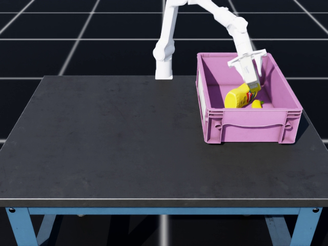

# ATEC Task E — RGB-D Piper 抓放策略

自主 RGB-D 几何感知、类别专用抓取参数、Piper FK/解析雅可比/阻尼 IK 和闭环状态机。顺序固定为 **香蕉 → 芥末瓶 → 糖盒**，不加载 ACT 或其他训练权重。

## 实测结果

RTX 4090、Isaac Sim 5.1 / Isaac Lab 环境下，种子 42 三次完整运行均为 **18/18**，原生终止条件 `basket_success`。最终录像对应仿真耗时 63.76 秒。未为提高分数修改奖励、终止条件或场景配置。

- [最终结果及源码哈希](results/seed42/result.json)
- [成功视频](results/seed42/rgbd_success.mp4)
- [视频元数据](results/seed42/video_metadata.json)
- [完整验收说明](docs/RGBD_SUCCESS.md)



这些是同一种子的重复验证，不代表跨种子成功率。原生成功判定后立即结束，没有额外静置稳定性测试。

## 安装与运行

先准备 NVIDIA GPU、驱动及匹配的 Isaac Sim / Isaac Lab Python 环境。原交接工程标注 Isaac Lab 2.3.2；本次成功运行使用 Isaac Sim 5.1。仿真框架不包含在仓库中。

```bash
git clone https://github.com/chen-jiale/ATEC_TASKE.git
cd ATEC_TASKE
python -m pip install -r requirements.txt
python -m pip install --no-deps -e ./source/atec_rl_lab
export PYTHONPATH="$PWD/source/atec_rl_lab:$PWD${PYTHONPATH:+:$PYTHONPATH}"
python -u scripts/play_atec_task.py \
  --headless --enable_cameras --video --camera_video \
  --video_length 5000 --seed 42 --output_dir logs/my_seed42
```

`python` 必须来自 Isaac Lab 环境。仓库包含机器人、场景、三件物体与材质，保持 `source/` 和 `atec_robot_model/` 的相对布局。

原服务器可直接使用 `bash scripts/run_rgbd_headless.sh my_seed42 42`，另一个终端通过 `tail -f logs/my_seed42/run.log` 观察进度。该脚本固定使用 `/opt/conda/envs/isaaclab/bin/python`；其他机器使用上面的通用命令。每次使用新的输出目录。

## 实现

- `demo/solution.py`：统一入口，导出 RGB-D `AlgSolution`。
- `demo/solution_rgbd.py`：抓取、抬升验证、搬运、释放和有限重试。
- `demo/rgbd/perception.py`：颜色/连通域分割与深度几何定位。
- `demo/piper_kinematics.py`：自主 FK、雅可比和 IK。
- `demo/rgbd_vbc_alore.py`：相机模型及阶段规划辅助代码。
- `scripts/play_atec_task.py`：headless 评测、录像、重置前成功取证。

策略只使用标准观测及接口允许的累计分数。物体真值只用于评测器诊断，不传入策略。感知依赖固定相机、颜色和空间先验，香蕉定位包含简化的桌面几何估计。

文件名中的 VBC/ALORE 是早期命名，**不表示复现论文**：没有 Tracking SAM、学习式全身控制、ALORE 物体速度控制或任务与运动联合优化。

## 发布范围

保留当前源码、运行必需资产、原许可证与来源记录，附成功视频及轻量验收证据。历史 ACT 源码保留作参考，默认入口不使用它。ACT 权重、数据集、临时日志和缓存不发布。

`docs/ORIGINAL_HANDOFF_README.md`、`README0929.md`、`ORIGIN_MANIFEST.json` 和 `SHA256SUMS` 保留原交接背景，部分内容针对旧版 ACT。原哈希清单不代表当前发布快照，旧交接检查也可能因排除权重而失败。当前运行方式及验证结论以本页和 `docs/RGBD_SUCCESS.md` 为准。
